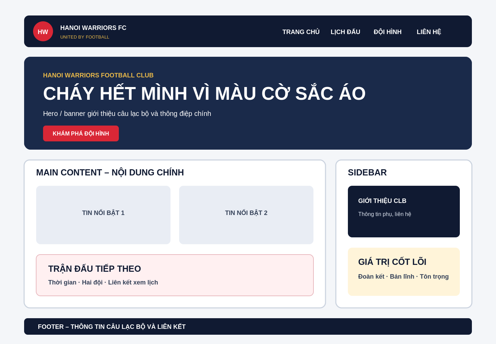
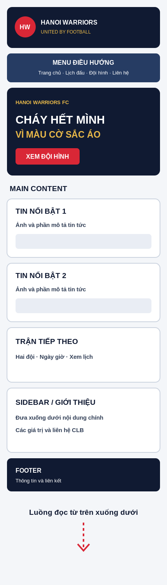

# BÁO CÁO BÀI TẬP LỚN A3

## XÂY DỰNG WEBSITE CÂU LẠC BỘ BÓNG ĐÁ HANOI WARRIORS FC BẰNG HTML5/CSS3

**Học phần:** Thiết kế web và triển khai HTPM  
**Sinh viên:** Phan Anh Tài  
**Mã sinh viên:** 2071020166  
**Lớp:** 20-04  
**Giảng viên:** ThS. Lê Thái Bảo  
**Năm:** 2026

> **Phạm vi và tính trung thực của báo cáo:** Tài liệu mô tả mã nguồn đã được chỉnh sửa và các quyết định thiết kế. Hanoi Warriors FC cùng tên cầu thủ, đối thủ, lịch thi đấu, tỷ số và tin tức là dữ liệu giả lập. Những việc cần tài khoản/thiết bị của sinh viên như kiểm thử trên máy Windows, tạo/push GitHub Repository, xuất bản Pages và quay video demo được đánh dấu **Chưa thực hiện/Chưa xác nhận** cho đến khi có minh chứng.

## MỤC LỤC

1. Giới thiệu dự án  
2. TC1 – Phân tích yêu cầu và đánh giá phương án  
3. TC2 – Thiết kế giao diện và cấu trúc  
4. TC3 – Phát triển và triển khai  
5. TC4 – Đánh giá và kiểm thử  
6. TC5 – Báo cáo và bàn giao  
7. TC6 – Phản biện và demo  
8. TC7 – Quy cách và khai báo AI  
9. Kết luận và hướng phát triển

## 1. GIỚI THIỆU DỰ ÁN

### 1.1. Lý do chọn đề tài

Bóng đá có nhiều nhóm thông tin mà người hâm mộ thường xuyên theo dõi như tin tức, lịch thi đấu, kết quả, đội hình và thông tin liên hệ. Website câu lạc bộ là một đề tài phù hợp để thực hành cấu trúc nội dung HTML5, tổ chức bố cục CSS3 và thiết kế responsive.

### 1.2. Mục tiêu

- Xây dựng website tĩnh gồm bốn trang HTML có điều hướng thống nhất.
- Sử dụng HTML5 ngữ nghĩa để tổ chức nội dung.
- Vận dụng CSS Grid, Flexbox và Media Queries.
- Tạo form có kiểm tra dữ liệu bằng HTML5 và JavaScript phía trình duyệt.
- Chuẩn bị mã nguồn, tài liệu và quy trình GitHub Pages để người học triển khai.

### 1.3. Công nghệ và cấu trúc

HTML5, CSS3, JavaScript thuần, Git, GitHub và GitHub Pages. Các tệp chính gồm `index.html`, `schedule.html`, `squad.html`, `contact.html`, `style.css`, `script.js`, thư mục ảnh SVG, `README.md`, `AI_LOG.md` và tài liệu trong `docs/`.

## 2. TC1 – PHÂN TÍCH YÊU CẦU VÀ ĐÁNH GIÁ PHƯƠNG ÁN (15%)

### 2.1. Ai sẽ xem website?

| Đối tượng | Nhu cầu | Ưu tiên |
|---|---|---|
| Cổ động viên | Xem tin tức, lịch, kết quả và đội hình | Chính |
| Hội viên/người muốn tham gia | Tìm hiểu hoạt động và gửi thông tin đăng ký | Cao |
| Ban quản trị CLB | Giới thiệu hình ảnh và hoạt động | Cao |
| Đối tác/nhà tài trợ | Tìm hiểu CLB và kênh liên hệ | Trung bình |

Cổ động viên là nhóm trọng tâm, do đó trang chủ ưu tiên banner nhận diện, tin nổi bật và trận đấu tiếp theo. Menu luôn xuất hiện ở đầu trang để người xem chuyển nhanh tới lịch, đội hình và liên hệ.

### 2.2. Họ cần làm gì?

1. Xem giới thiệu và giá trị của câu lạc bộ.
2. Xem lịch thi đấu, kết quả, cặp đấu và trạng thái.
3. Xem cầu thủ theo bốn vị trí: thủ môn, hậu vệ, tiền vệ, tiền đạo.
4. Đọc tin tức/thông báo mẫu.
5. Mở trang liên hệ và điền thông tin vào form.
6. Điều hướng giữa bốn trang qua logo, menu và các CTA.

Form hiện chỉ xác thực ở trình duyệt. Website chưa gửi email, lưu dữ liệu hoặc quản lý đăng ký thành viên.

### 2.3. Website có gì?

| Trang | Tệp | Nội dung |
|---|---|---|
| Trang chủ | `index.html` | Giới thiệu, tin nổi bật, trận tiếp theo và sidebar |
| Lịch thi đấu | `schedule.html` | Ngày, cặp đấu, tỷ số, trạng thái |
| Đội hình | `squad.html` | Thẻ cầu thủ theo bốn vị trí |
| Liên hệ | `contact.html` | Form đăng ký/liên hệ demo và thông tin CLB |

### 2.4. Kiểm tra bằng cách nào?

- Mở đủ bốn trang và kiểm tra tiêu đề, nội dung, CSS và ảnh.
- Nhấn logo, menu và CTA để kiểm tra liên kết.
- Dùng DevTools tại 375px, 430px, 768px và 1366px.
- Thử form với dữ liệu thiếu, email sai, số điện thoại sai, thiếu vai trò, thiếu xác nhận và dữ liệu hợp lệ.
- Sau khi triển khai, mở URL Pages và đối chiếu với commit cuối.

### 2.5. Phạm vi dự án

| Hạng mục | Trong phạm vi | Ngoài phạm vi |
|---|---|---|
| Bốn trang HTML và giao diện CSS | Có | – |
| Responsive/Grid/Flexbox | Có | – |
| Lịch, cầu thủ, tin tức | Dữ liệu minh họa tĩnh | API trực tiếp/CMS |
| Form | Xác thực trình duyệt và thông báo demo | Lưu/gửi dữ liệu thật |
| Đặt vé, thanh toán, tài khoản | – | Có |
| Backend và cơ sở dữ liệu | – | Có |
| GitHub/GitHub Pages | Hướng dẫn và source sẵn sàng | Chưa được xác nhận đã xuất bản |

### 2.6. Acceptance Criteria

| ID | Tiêu chí | Cách nghiệm thu | Kết quả mong đợi |
|---|---|---|---|
| AC01 | Có bốn tệp HTML đúng tên | Kiểm tra thư mục | Đủ bốn trang |
| AC02 | Có header, nav, main, footer | Kiểm tra HTML | Đủ cấu trúc chung |
| AC03 | Menu/logo điều hướng đúng | Nhấn từng liên kết | Mở đúng trang |
| AC04 | Trang chủ có giới thiệu, tin và trận tiếp | Mở trang chủ | Có đủ ba nhóm nội dung |
| AC05 | Bảng lịch đủ cột | Mở lịch đấu | Có ngày, trận, tỷ số, trạng thái |
| AC06 | Đội hình đủ bốn vị trí | Mở đội hình | Có thủ môn, hậu vệ, tiền vệ, tiền đạo |
| AC07 | Form chặn dữ liệu không hợp lệ | Thử form | Hiện validation phù hợp |
| AC08 | Form nói rõ giới hạn | Kiểm tra thông báo | Không tuyên bố gửi/lưu thật |
| AC09 | Không tràn ngang toàn trang ở các viewport | DevTools | Nội dung không tràn toàn trang |
| AC10 | Cỡ chữ phụ tối thiểu 12px | Kiểm tra CSS | Không còn cỡ chữ dưới 12px |
| AC11 | Tương phản chữ thường đạt AA ở cặp màu chính | Tính tỷ lệ tương phản | Ít nhất 4.5:1 |
| AC12 | CSS/JS/ảnh nội bộ tải đúng | Network/Console | Không thiếu tài nguyên |
| AC13 | Repository có source và commit | GitHub | Có file và lịch sử commit |
| AC14 | Pages chạy đúng phiên bản | Mở URL và đối chiếu commit | URL mở được và đúng source |

### 2.7. Đánh giá và chọn phương án

| Phương án | Ưu điểm | Hạn chế | Quyết định |
|---|---|---|---|
| Một trang (one-page) | Đơn giản, ít tệp, điều hướng anchor | Nội dung lịch/đội hình/tin/liên hệ dài, phải cuộn nhiều | Không chọn |
| Nhiều trang tĩnh | Mỗi nhóm nội dung có URL riêng; dễ kiểm thử; không cần backend; phù hợp GitHub Pages | Dữ liệu cập nhật thủ công; không có CMS | **Chọn** |
| CMS/backend | Có thể quản trị tin, tài khoản, lịch và lưu đăng ký | Cần server, database, bảo mật và vận hành; vượt phạm vi A3 | Không chọn trong bản A3 |

Em chọn website tĩnh nhiều trang vì đề tài có bốn nhóm nội dung độc lập và mục tiêu học phần tập trung HTML5/CSS3. CMS/backend chỉ cần thiết khi dự án phát triển thành sản phẩm có nội dung cập nhật thường xuyên hoặc cần lưu dữ liệu người dùng.

## 3. TC2 – THIẾT KẾ VÀ CẤU TRÚC (20%)

### 3.1. Wireframe Desktop



Header chứa logo và menu; hero/banner tạo nhận diện và CTA; vùng main hiển thị tin và trận đấu; sidebar chứa giới thiệu/giá trị; footer đặt thông tin phụ và liên kết. Bố cục hai cột tận dụng chiều ngang desktop, giúp tin/lịch nằm ở vùng đọc chính còn nội dung phụ nằm bên phải.

### 3.2. Wireframe Mobile



Trên mobile, header và menu xếp dọc; banner, tin, trận tiếp theo và sidebar chuyển thành một cột. Sidebar đặt sau nội dung chính vì mức ưu tiên thấp hơn. Bảng lịch cuộn ngang trong wrapper riêng để không làm toàn bộ trang rộng hơn viewport.

### 3.3. Quy chuẩn màu sắc và chữ

| Vai trò | HEX | Cách dùng |
|---|---|---|
| Navy | `#101A32` | Header, nền đậm, tiêu đề |
| Đỏ | `#D92736` | CTA và điểm nhấn |
| Vàng | `#E9B949` | Điểm nhấn trên nền navy |
| Nền | `#F4F6F9` | Nền trang |
| Trắng | `#FFFFFF` | Card và nền form |
| Nội dung | `#202B40` | Văn bản chính |
| Muted | `#536075` | Văn bản phụ |

Cặp màu chính được tính theo độ chói tương đối: `#536075` trên `#F4F6F9` đạt 5.88:1; trên trắng đạt 6.37:1; chữ trắng trên đỏ `#D92736` đạt 4.89:1; chữ trắng trên navy `#101A32` đạt 17.27:1; vàng `#E9B949` trên navy đạt 9.46:1. Các tỷ lệ này vượt 4.5:1 cho chữ thường đối với đúng các cặp màu đã nêu. Khi thay màu nền hoặc chữ cần tính lại.

Tiêu đề dùng Arial/Helvetica thay cho Impact để giữ glyph tiếng Việt có dấu đồng nhất. Các cỡ chữ CSS khai báo dưới 12px được nâng lên tối thiểu 12px; nội dung đọc chính khoảng 14–16px.

### 3.4. Breakpoint

| Breakpoint | Điều chỉnh | Lý do |
|---|---|---|
| 960px | Giảm sidebar và số cột cầu thủ | Bố cục vẫn cân đối trên tablet |
| 720px | Main/sidebar thành một cột; header/menu xếp dọc | Hai cột không còn đủ không gian thoải mái |
| 500px | Card, sidebar, form xếp một cột | Tránh ép nội dung trên điện thoại nhỏ |

## 4. TC3 – PHÁT TRIỂN VÀ TRIỂN KHAI (25%)

### 4.1. Cấu trúc mã nguồn

```text
hanoi-warriors-fc/
├── index.html
├── schedule.html
├── squad.html
├── contact.html
├── style.css
├── script.js
├── assets/images/
├── docs/
├── evidence/
├── README.md
└── AI_LOG.md
```

### 4.2. Tổ chức HTML5

Bốn trang sử dụng `lang="vi"`, meta viewport, title, description, favicon, liên kết stylesheet dùng chung, skip-link và cấu trúc semantic. Navigation đánh dấu trang hiện tại bằng `aria-current="page"`; hình ảnh nội dung có `alt` mô tả.

### 4.3. CSS và responsive

`style.css` định nghĩa biến màu trong `:root`, layout Grid/Flexbox, trạng thái hover/focus, bảng có wrapper cuộn ngang và ba breakpoint 960/720/500px. `minmax(0, 1fr)` cho phép cột Grid co lại nhỏ hơn kích thước min-content, hạn chế nội dung dài đẩy rộng toàn layout. `.table-scroll { overflow-x: auto; }` giới hạn thao tác cuộn ngang vào bảng lịch.

### 4.4. Xử lý form

Trong `script.js`, `event.preventDefault()` ngăn hành vi submit mặc định do dự án chưa có endpoint. `form.reportValidity()` yêu cầu trình duyệt kiểm tra các thuộc tính HTML5 như `required`, `type="email"` và `pattern`. Nếu hợp lệ, script hiện thông báo demo. Form không gửi email và không lưu dữ liệu.

### 4.5. Triển khai

Source đã có `.nojekyll`, `.gitignore` và hướng dẫn tại `docs/GITHUB_PAGES.md`. Người học cần tự tạo Repository, cấu hình remote, push nhánh `main`, bật Settings → Pages → Deploy from a branch → `main` → `/(root)`, sau đó mở URL mà GitHub hiển thị. **Repository, commit ID và URL Pages thực tế hiện chưa được xác nhận**, vì cần thao tác trên tài khoản GitHub của sinh viên.

## 5. TC4 – ĐÁNH GIÁ VÀ KIỂM THỬ (20%)

### 5.1. Kế hoạch kiểm thử

Kế hoạch test case nằm trong `docs/TEST_CASES.md`, gồm responsive, liên kết, form, nội dung các trang và triển khai GitHub Pages. Mỗi trường hợp dùng chu trình: mong đợi → thao tác thử → kết quả thực tế → minh chứng → sửa lỗi/thử lại.

### 5.2. Các sửa đổi mã nguồn theo phản hồi đánh giá

| Vấn đề được phản hồi | Thay đổi trong bản sửa | Cách kiểm chứng sau khi tải xuống |
|---|---|---|
| Cỡ chữ 7–11px quá nhỏ | Nâng khai báo cỡ chữ phụ lên tối thiểu 12px; nội dung chính 14–16px | Kiểm tra `style.css` và thử trên 375px |
| `--muted` có tương phản 4.11:1 | Đổi thành `#536075`; đo lại 5.88:1 trên paper và 6.37:1 trên trắng | Đối chiếu bảng màu trong `DESIGN_DECISIONS.md` |
| Impact có nguy cơ thiếu glyph tiếng Việt | Dùng Arial/Helvetica cho font display và body | Mở tiêu đề có dấu trên Chrome Windows |
| HTML dồn dòng | Dàn lại bốn trang thành nhiều dòng | Mở từng tệp trong VS Code |
| TC1 thiếu bốn câu trả lời/Acceptance Criteria | Bổ sung `TC1_REQUIREMENTS.md` và phần 2 của báo cáo | Đối chiếu bảng và câu trả lời |
| TC2 thiếu wireframe/lý do | Bổ sung SVG/PNG Desktop/Mobile và tài liệu quyết định thiết kế | Mở thư mục `docs/wireframes/` |

### 5.3. Trạng thái kiểm thử thực tế

| Nội dung | Trạng thái hiện tại |
|---|---|
| Kiểm tra cấu trúc file, thẻ và liên kết nội bộ bằng rà soát source | Đã rà soát trong bản sửa; cần mở lại trên máy sinh viên |
| Kiểm tra responsive trên Chrome Windows 375/430/768/1366px | Đã kiểm tra trên máy sinh viên |
| Kiểm tra tương tác form trên Chrome Windows | Đã kiểm tra trên máy sinh viên |
| Kiểm tra URL GitHub Pages | Đã kiểm tra – chưa có URL đã xác nhận |
| Đối chiếu commit và phiên bản public | Đã kiểm tra – chưa có commit/URL đã xác nhận |
| Quay demo của sinh viên | Chưa thực hiện |

Không điền “Đạt” cho các mục chưa được chạy trên thiết bị tương ứng. Môi trường, ngày kiểm thử và ảnh chụp phải được cập nhật từ thao tác thật của người học.

## 6. TC5 – BÁO CÁO VÀ BÀN GIAO (10%)

Bộ bàn giao gồm source, `README.md`, `AI_LOG.md`, báo cáo này, tài liệu phân tích yêu cầu, quyết định thiết kế, wireframe, test case, hướng dẫn GitHub Pages và thư mục minh chứng. README mô tả dự án từ góc nhìn tác giả; các thông tin triển khai chưa có thật được ghi rõ là chưa xác nhận.

## 7. TC6 – PHẢN BIỆN VÀ DEMO (5%)

Kịch bản 3 phút và 10 câu hỏi phản biện nằm trong `docs/DEMO_3_MINUTES.md`. Các nội dung trọng tâm cần giải thích: lý do chọn nhiều trang tĩnh, Grid/Flexbox, breakpoint 720px, ý nghĩa `minmax(0, 1fr)`, `reportValidity()`, `preventDefault()`, Git commit và giới hạn GitHub Pages. Video demo chỉ được bổ sung sau khi sinh viên trực tiếp trình diễn; hiện chưa có video được xác nhận.

## 8. TC7 – QUY CÁCH VÀ KHAI BÁO (5%)

Tên tệp và thư mục thống nhất theo TC1–TC7. `AI_LOG.md` ghi lại các yêu cầu hỗ trợ AI đã xuất hiện trong cuộc hội thoại, nội dung được AI hỗ trợ và các việc người học cần tự xác nhận. ChatGPT được ghi nhận là công cụ đã dùng trong cuộc hội thoại này; nếu người học sử dụng thêm công cụ AI khác thì phải bổ sung trung thực.

Repository dự kiến có tên `hanoi-warriors-fc`. URL Pages dự kiến theo tài khoản `taiphan208` là `https://taiphan208.github.io/hanoi-warriors-fc/`, nhưng **chưa được xác nhận hoạt động**. Không đưa URL này vào phần kết quả đã đạt nếu chưa triển khai thành công.

## 9. KẾT LUẬN VÀ HƯỚNG PHÁT TRIỂN

Bản sửa đã bổ sung nội dung TC1, wireframe và lý do thiết kế TC2, cải thiện khả năng đọc và tương phản của giao diện, thay font tiêu đề, định dạng lại HTML và hoàn thiện các tài liệu README, AI_LOG, báo cáo và demo. Các giới hạn quan trọng được giữ rõ: dữ liệu đội bóng là giả lập; form chỉ xác thực phía trình duyệt; Repository, Pages URL, kiểm thử trên Windows và video demo cần được sinh viên thực hiện và xác nhận.

Nếu tiếp tục phát triển, có thể bổ sung JavaScript cho lọc lịch, CMS/backend cho tin tức, cơ sở dữ liệu cho đội hình và một dịch vụ form có chính sách bảo vệ dữ liệu. Những phần này nằm ngoài phạm vi website tĩnh A3 hiện tại.
